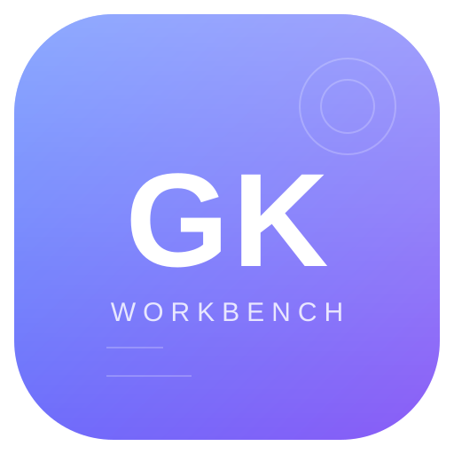
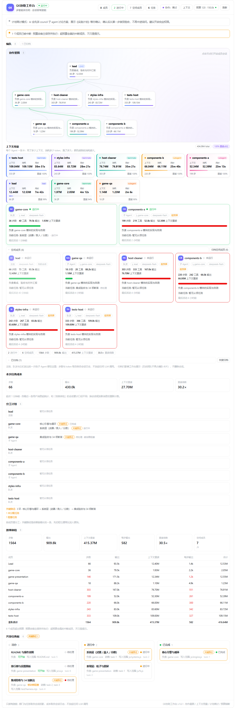
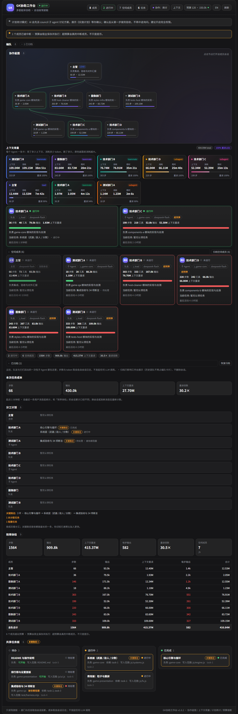
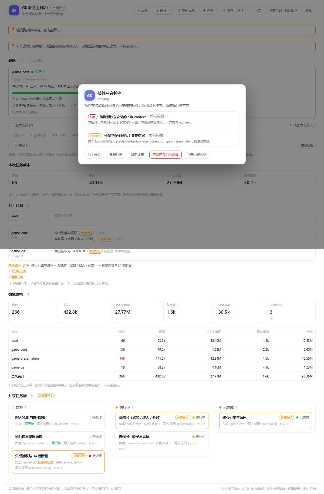
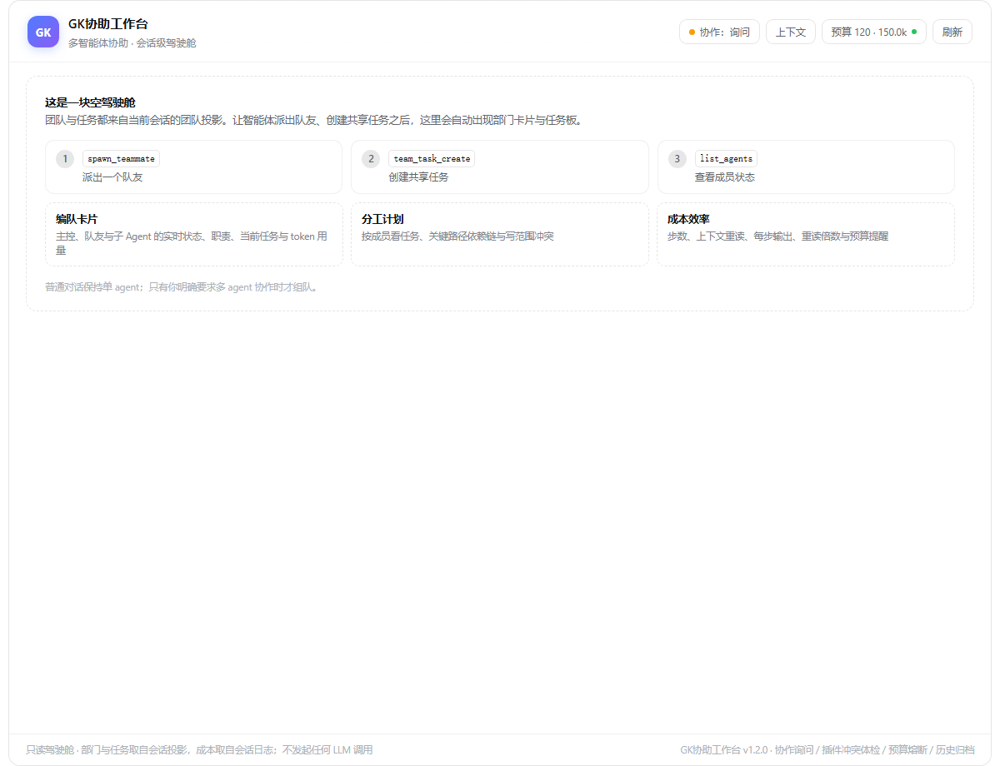
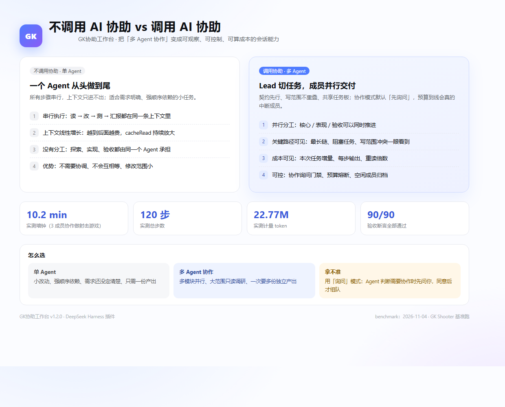

<p align="center">
  
</p>

<h1 align="center">GK协助工作台</h1>

<p align="center">
  <b>把「多 Agent 协作」变成可观察、可控制、可算成本的会话能力。</b><br>
  DeepSeek Harness 插件 · 编队卡片 / 分工计划 / 协作询问门禁 / 预算熔断 / 本次任务成本 / 插件冲突体检
</p>

<p align="center">
  
  
  
  
</p>

---

## 这是什么

DSH 里 Agent Teams 已经能让一个会话派出多个 agent，但用户侧缺三样东西：

1. **协作失控**：AI 什么时候该组队、要不要先问你，没有硬约束；
2. **成本不可见**：token 烧得快，但不知道一次协作到底花了多少；
3. **状态不可见**：谁在跑、卡在哪、关键路径多长、预算有没有超。

GK协助工作台把这三件事补上：工作台页实时展示编队/任务/成本，协作模式默认「先询问」，预算到线会**真的中断**超预算成员；首次加载还会检查已装插件是否冲突。



## 核心能力

| 能力 | 说明 |
|---|---|
| **编队卡片** | 主控 / 队友 / 子 Agent 的状态、职责、当前任务、步数/输出/重读、最后活动；空闲成员折叠 |
| **分工计划** | 按成员列任务，标注关键路径、未分配、阻塞、写范围冲突 |
| **共享任务板** | 待办 / 进行中 / 已完成，关键路径任务高亮 |
| **协作模式（询问）** | 默认先问：AI 判断需要协作时必须先 `ask_user_question` 征得同意；未询问前协作工具被宿主拒绝 |
| **计划商讨（council）** | 不明确的任务先派 2-3 个 council 子 agent 讨论出方案，展示《实施计划》，确认后一次做到验收、不再中途询问 |
| **新对话模式预设** | 新对话的模式下拉里直接选「计划商讨模式」，该会话自动进入商讨流程 |
| **预算熔断** | 按「本次任务」统计，超预算的 running 成员被 `agentTeams.interrupt`，并拒绝继续派活 |
| **本次任务成本** | 自最近一条人类消息起算的步数 / 输出 / 重读 / 重读倍数 |
| **历史归档** | 空闲成员一键归档，不再占卡片；可展开恢复 |
| **插件冲突体检** | 首次加载扫描 profile，发现冲突自动弹窗 + 开「插件体检」对话，让你选自主修复 / 停用 |
| **操作审计接口** | `/agent-cockpit/*` 只读接口 + `state` / `doctor` 管理接口，便于做外部面板 |

## 截图

| 有团队（浅色） | 有团队（深色） |
|---|---|
|  |  |

| 首次加载冲突体检 | 空状态 |
|---|---|
|  |  |

## 调用 AI 协助 vs 不调用



| 维度 | 不调用协助（单 Agent） | 调用协助（GK工作台） |
|---|---|---|
| 执行方式 | 串行，读→改→测→汇报同一条上下文 | Lead 切任务，成员并行，写范围不重叠 |
| 上下文成本 | 线性增长，cacheRead 持续放大 | 成员短会话；本次任务增量单独统计 |
| 关键路径 | 就是总步数 | 可看到最长链，优先切短它 |
| 验收 | 自己写、自己跑、自己验 | 独立 QA 写 harness，90+ 断言 |
| 失控风险 | 低 | 有询问门禁 + 预算熔断兜底 |
| 适合 | 小改动、强顺序依赖、需求未定 | 多模块并行、大范围调研、多份独立产出 |

**实测（2026-11-04，同一台机器、同一模型）**：3 成员协作做一个完整射击小游戏（GK Shooter）：

| 指标 | 数值 |
|---|---|
| 墙钟 | **10.2 分钟** |
| 总步数 | **120** |
| 计量 token | **22.77M**（输出 163.5k，重读 22.35M，重读倍数 53.6×） |
| 验收 | **90/90 断言通过** |

同一套机制下对比首跑（4 成员、无询问门禁）：墙钟 −52%、步数 −59%、输出 −64%、最长链 −76%。完整报告见 [docs/BENCHMARK.md](docs/BENCHMARK.md)。

> 结论：不是所有任务都该开协作。小任务单 Agent 更快；多模块任务用工作台，并把协作模式放在「询问」。

## 快速开始

> 要求：Windows + DeepSeek Harness（DSH）已安装并至少启动过一次。

```powershell
git clone https://github.com/GKone-gzh/deepseek-GK-ai gk-assist-workbench
cd gk-assist-workbench
powershell -NoProfile -ExecutionPolicy Bypass -File tools\install.ps1
```

脚本会：复制工作台到 `<DSH_HOME>\plugins\dsh-agent-cockpit`、复制上下文引擎到 profile 的 `node_modules`、登记 bundle、建立目录联接。完成后**重启 DSH**。

手动安装、升级、卸载见 [docs/INSTALL.md](docs/INSTALL.md)。

## 用法

### 1. 打开工作台

会话顶部标签：`上下文` / **`GK协助工作台`**（不再有独立「编队」页）。输入框上方只有在该会话确有团队时才出现 `GK协助` 徽章。

### 1b. 新对话直接选「计划商讨模式」

新对话页的 Agent 模式下拉（标准模式 / 计划商讨模式 / 创造模式）里选 **计划商讨模式**，该会话会：

- 用同名系统提示段遮盖默认协作提示，直接注入两阶段协议；
- 首次组装提示时把该会话协作模式写成 `council`，页头显示「商讨」，`ask_user_question` 被拒；
- 之后按「商讨 → 你确认 → 一次做到验收」执行。

工作台页头的四态按钮仍然可用；已经开始的会话也可以直接切成「商讨」，效果相同。

### 2. 协作模式（四态循环）

页头按钮 `协作：询问 / 自动 / 商讨 / 关闭`：

- **询问（默认）**：单 Agent 能做的事直接做；AI 判断确实需要协作时，必须先 `ask_user_question` 说明「为什么需要、派几个 agent、各自负责什么」，你同意后才能 `spawn_teammate` / 建任务。宿主按「最近一条人类消息之后是否问过」硬校验，不问就调协作工具会被拒绝。
- **自动**：模型自己决定，不需要先问。
- **商讨（council）**：给不明确的任务用。收到任务后先派 2-3 个 council 子 agent，从「最省事的可行方案 / 风险与反例 / 实现与验收」三个角度讨论，合并成《实施计划》（目标、范围、默认假设、步骤、验收标准、风险与回退、预算）展示给你；**你确认后**从第一步做到验收，不再中途询问。宿主在商讨模式拒绝 `ask_user_question`，需要你决定的内容必须一次写进计划。建议开启完全权限，避免执行期被沙箱拦。
- **关闭**：拒绝全部协作类工具。

模式保存在 `<DSH_HOME>\plugins\dsh-agent-cockpit\state.json`，按根会话隔离；新会话默认 `ask`。

### 3. 预算与熔断

页头 `预算` → 填「步数上限 / 输出上限」。宿主每 10 秒按本次任务统计一次，超预算且仍在运行的队友会被中断；熔断后拒绝继续派活。预算变更会立即做一次检查。

### 4. 历史归档

空闲成员折叠条右侧 `归档空闲成员`；归档只影响工作台展示，不删会话、不影响成本。

### 5. 插件冲突体检

首次加载（或版本变化后第一次）扫描 profile：

- 独立安装的 `dsh-context`、重复包名、重复宿主行、多个团队工具提供者、引擎缺失；
- 有冲突时自动弹窗 + 新建「插件体检」对话说明；
- 三个动作：**自主修复**（备份后移除冲突项，重启生效）、**不使用我们的插件**（从 bundles 移除，重启生效）、**暂不处理**。

## 架构

```
DSH（宿主）
├─ agent-cockpit              ← 本插件（工作台 UI + /agent-cockpit/* + 协调/预算/体检）
│   ├─ client.js              工作台页、徽章、冲突弹窗
│   ├─ host/usage.js          会话日志解码、增量统计
│   ├─ host/family.js         编队数据（agentTeams + subagents）
│   ├─ host/state.js          state.json（模式/预算/归档/doctor）
│   ├─ host/coordination.js   全局工具 guard + 系统提示 + 预算定时器
│   └─ host/doctor.js         首次加载冲突扫描 / 修复 / 停用
└─ agent-cockpit-context      ← 内置上下文分析引擎（dsh-context-core，Apache-2.0）
    └─ 上下文页 / 洞察 / 侧边栏 / /context / 提示词前后缀
```

- **协作门禁**：`tools.guard` + `systemPrompt.section` 全局注册一次；`ask` 模式按 `session/event` 里「人类消息 / ask_user_question」的时间判定。
- **预算熔断**：10 秒 tick，按「本次任务」聚合 `steps/ output`，超线 interrupt。
- **数据**：只读会话日志（多帧 zstd）与宿主服务，不写会话、不调 LLM；`family` / `taskcost` 有 3 秒缓存。
- **状态**：`<DSH_HOME>\plugins\dsh-agent-cockpit\state.json`，临时文件 + rename，最多保留 200 条会话。

接口：

```
GET  /agent-cockpit/family?lead=<id>&session=<id>
GET  /agent-cockpit/usage?lead=<id>&ids=<id,id>
GET  /agent-cockpit/context?session=<id>&limit=24
GET  /agent-cockpit/insights?limit=12
GET  /agent-cockpit/taskcost?lead=<id>
GET  /agent-cockpit/state?session=<id>
POST /agent-cockpit/state  { session, mode?, budget?, archived? }
GET  /agent-cockpit/doctor
POST /agent-cockpit/doctor { action: fix|optout|dismiss|rescan }
GET  /agent-cockpit/coorddebug
```

## 验收

```powershell
powershell -NoProfile -ExecutionPolicy Bypass -File tools\verify.ps1
# 或
node packages\dsh-agent-cockpit\test\verify-all.mjs http://127.0.0.1:<port>
```

当前版本：**13/13 通过**（state / usage-since / coordination / doctor / doctor-conversation 五个宿主单测 + 两个客户端渲染冒烟 + 线上 doctor/state/family/taskcost）。

## 已知限制

- `mode=off/ask` 只拦协作类工具，不拦普通工具；已派出的队友仍能干完自己的活。
- 预算熔断只中断正在运行的成员，不撤销已完成工作；窗口按最近人类消息重置。
- 自动修复只覆盖已知冲突（dsh-context / 重复包名 / 重复宿主行）；团队工具重复、引擎缺失只报告。
- 门禁依赖 Agent scope 上的 `tools.guard` / `systemPrompt.section`，DSH 升级后请跑一次 `coordination-test.mjs` 回归。
- 首次加载的「插件体检」对话会消耗一次模型调用；失败时只保留弹窗。
- 计划商讨的「不中途询问」由宿主禁用 `ask_user_question` + 提示词约束共同保证；模型仍可能自己提前结束，建议在计划里把验收标准写死。
- 商讨模式会多花 2-3 个 council 子 agent 的 token；不明确任务才用，小改动用单 Agent 更快。
- 安装依赖手动目录挂载（本机 pnpm store v10/v11 不一致，官方 `plugin_manager install_bundle` 不可用）。

## 目录

```
packages/dsh-agent-cockpit/   工作台插件（MIT）
packages/dsh-context-core/    内置上下文引擎（Apache-2.0，源自 dsh-context v0.79.0）
tools/install.ps1             安装
tools/sync.ps1                同步到运行位置
tools/verify.ps1              一键验收
tools/preview-cockpit.mjs     静态预览生成（contributor 用）
docs/INSTALL.md               安装/升级/卸载/排错
docs/BENCHMARK.md             协作基准报告
```

## License

- 本插件：MIT（见 [LICENSE](LICENSE)）
- 内置上下文引擎：Apache-2.0（见 [packages/dsh-context-core/LICENSE](packages/dsh-context-core/LICENSE) 与 [NOTICE.md](NOTICE.md)）
- 第三方致谢见 [NOTICE.md](NOTICE.md)
